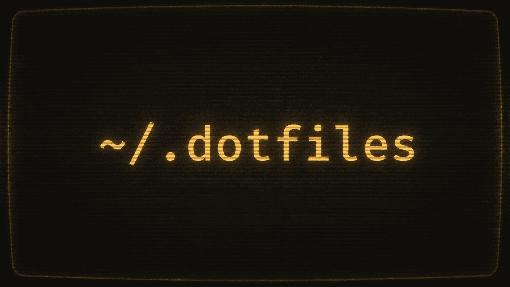

Portable, version-controlled macOS setup including advanced tooling for Zsh, Homebrew, SSH, Node.js, AI agents, and more.

> [!WARNING]
> This is a highly opinionated setup. Every default reflects my personal preference, not what I would recommend to anyone else.
>
> Before using the following files, fork this repository, review its content, and remove or change things you don't want or need. **Don't blindly use my settings** unless you know what you are doing. Use at your own risk.

## Features

#### Version-controlled home directory

The home directory is version-controlled. The [`.gitignore`](/.gitignore) acts as an allowlist, so files are tracked only once opted-in and nothing leaks by accident. Git hooks run natively with no extra tooling.

#### Single script to install everywhere

[`.install.sh`](/.install.sh) clones the repo, copies every managed file into the home, and sets up Homebrew, runtimes, packages, and all other managed tools. It confirms before overwriting and backs up whatever it replaces.

#### Synced Brewfile to manage all dependencies

[`Brewfile`](/.homebrew/Brewfile) pins formulae, casks, and App Store apps. The wrapped `brew` command keeps everything synchronized, and `brew fresh` updates, upgrades, cleans, dumps, and runs health checks in one go.

#### Fast and powerful shell configuration

Oh My Zsh runs with local plugins and themes under [`.zsh`](/.zsh). Plugins extend the shell with profile management, runtime version switching and installation, completions, and more. The custom themes display active runtime and package manager versions and indicators for available upgrades.

#### Managed runtimes and dependencies

Node, Python, and Ruby are managed with nodenv, pyenv, and rbenv. The [`lts`](/.zsh/plugins/lts/lts.plugin.zsh) plugin installs and manages the latest LTS release of each runtime.

#### Single source of truth for AI agents

The [`.agents`](/.agents) directory is the source for instructions, rules, skills, and hook scripts shared by Claude Code, Codex, and any compatible agent. All shared configurations use relative symlinks back to the agents folder, while tool-specific settings are kept separate.

#### Smart symbolic links

Managed files are linked into the locations each tool expects. When an application rewrites a linked file in place, `dotfiles init` restores the link and `dotfiles doctor` reports the drift.

#### Extended iCloud synchronization

The home `Downloads`, `Movies`, `Music`, and `Pictures` folders are replaced with relative symbolic links to iCloud Drive, so their contents sync across devices while paths stay stable and portable.

## Installation

Run the install script to bootstrap the configuration:

```sh
sh -c "$(curl -fsSL https://raw.githubusercontent.com/gabrielecanepa/dotfiles/HEAD/.install.sh)"
```

The script does the following:

1. Installs the configuration by shallow-cloning the repository into a temporary directory (removed on exit, error or interrupt) and copying each managed file into the home directory
2. Backs up the replaced files into a timestamped backup folder in the default state directory
3. Sets up Homebrew, packages, Oh My Zsh, runtimes, global dependencies, macOS defaults, agents, and iCloud symlinks

> [!IMPORTANT]
> Replacing the home `Downloads`, `Movies`, `Music`, and `Pictures` folders needs Full Disk Access for the terminal running the script, under System Settings > Privacy & Security. Without it the folders stay in place and the symbolic links are not created. Once the links exist, open Photos, Music, and TV holding Option to select or create their library under `~/Library`, otherwise each app writes a new library into iCloud Drive via the symlink.

## Manual setup

- [SSH](#ssh)
- [Homebrew](#homebrew)
- [Oh My Zsh](#oh-my-zsh)
- [Configuration](#configuration)
- [Git](#git)
- [Shell profile](#shell-profile)
- [Runtimes](#runtimes)
- [Node.js and package managers](#nodejs-and-package-managers)
- [Agents](#agents)
  - [Claude](#claude)
  - [Codex](#codex)
  - [Copilot](#copilot)
- [GUIs](#guis)
  - [Visual Studio Code](#visual-studio-code)
  - [Keybindings in Electron apps](#keybindings-in-electron-apps)
- [iCloud synchronization](#icloud-synchronization)

### SSH

If not already present, generate a new SSH key and copy it to the clipboard:

```sh
ssh-keygen -t ed25519 -C "<comment>"
tr -d '\n' < ~/.ssh/id_ed25519.pub | pbcopy
```

Add the key to [GitHub](https://github.com/settings/ssh/new), [GitLab](https://gitlab.com/-/profile/keys) and any other services you use.

### Homebrew

Install [Homebrew](https://brew.sh):

```sh
/bin/bash -c "$(curl -fsSL https://raw.githubusercontent.com/Homebrew/install/HEAD/install.sh)"
```

### Oh My Zsh

Install [Oh My Zsh](https://ohmyz.sh) and some useful community plugins:

```sh
/bin/bash -c "$(curl -fsSL https://raw.githubusercontent.com/ohmyzsh/ohmyzsh/HEAD/tools/install.sh)"

plugins=(
  zsh-users/zsh-autosuggestions
  zsh-users/zsh-completions
  zsh-users/zsh-syntax-highlighting
)

for plugin in ${plugins[@]}; do
  git clone https://github.com/${plugin}.git ${ZSH_CUSTOM:-~/.oh-my-zsh/custom}/plugins/${plugin}
done

# restart
zsh
```

### Configuration

The `.install.sh` script (see [Installation](#installation)) installs the configuration automatically.

> [!NOTE]
> Before overwriting an existing file, the script asks for confirmation (default _no_).
>
> Every replaced file is moved into a timestamped backup folder in the default state directory.
> To restore a file, just copy it back from that folder:
>
> ```sh
> backup="${XDG_STATE_HOME:-$HOME/.local/state}/dotfiles/backup"
> cp "$backup/<timestamp>/.zshrc" ~/.zshrc
> ```

To clone the repository locally:

```sh
gh repo clone gabrielecanepa/dotfiles
# or
git clone git@github.com:gabrielecanepa/dotfiles.git
```

Install the packages listed in `Brewfile`:

```sh
brew bundle --file ~/.homebrew/Brewfile
```

### Git

> [!NOTE]
> Skip this step if you cloned the repository with `gh repo clone` or `git clone` above, as your home directory is already version-controlled.

After adding your SSH key to GitHub, initialize `~` as a git repo that tracks the remote:

```sh
git -C ~ init -b main
git -C ~ remote add origin git@github.com:gabrielecanepa/dotfiles.git
git -C ~ fetch --depth 1 origin main && git -C ~ reset --hard FETCH_HEAD
```

This repository wires its own checks with local [Git hooks](https://git-scm.com/book/en/v2/Customizing-Git-Git-Hooks) running Oxfmt, ShellCheck, commitlint and other code quality tools on commit and push. The tracked [`.config/git/config`](/.config/git/config) enables them for the home repository only, through an `includeIf` block scoped to `~/.git`.

### Shell profile

Use the custom `profile` plugin to create your shell configuration with a guided prompt:

```sh
profile install
```

### Runtimes

Install the latest stable Node.js, Python, and Ruby versions using the `lts` plugin:

```sh
lts install
```

### Node.js and package managers

pnpm and the other package managers are installed by Corepack, which is enabled automatically by the nodenv install hook [`corepack.bash`](/.nodenv/nodenv.d/install/corepack.bash).

Global npm packages are tracked in [`.npm/package.json`](/.npm/package.json) using the custom Zsh plugin [`npm-global`](/.zsh/plugins/npm-global/npm-global.plugin.zsh): the wrapped `npm` command re-dumps the manifest after every global install or removal, the nodenv hook restores it into every new Node version, and `npm install -g` reinstalls it at any time.

Native tools like ShellCheck ship through Homebrew.

### Agents

Claude Code and Codex are installed manually, as the Homebrew versions lack some CLI features. Install both with their official installers:

```sh
curl -fsSL https://claude.ai/install.sh | bash -s latest
curl -fsSL https://chatgpt.com/codex/install.sh | sh
```

The CLIs are both downloaded to `~/.local/bin` and available in the PATH.

#### Claude

[`.claude/settings.json`](/.claude/settings.json) specifies the portable defaults for Claude Code: permissions, hooks, subagent limits, and the custom status lines in [`.claude/statusline.sh`](/.claude/statusline.sh). Instructions, rules, and skills are symlinks back to `.agents`.

Sign in on the first run:

```sh
claude
```

#### Codex

[`.codex/settings.toml`](/.codex/settings.toml) is the portable, shared configuration linked to the default system config in `/etc/codex/config.toml`. Project trust, hook state, and other machine-specific values are managed by Codex and stored in `~/.codex/config.toml`.

Create the symlink with:

```sh
# needs root privileges
sudo mkdir -p /etc/codex
sudo ln -sfn "$HOME/.codex/settings.toml" /etc/codex/config.toml
```

#### Copilot

[`.copilot/settings.json`](/.copilot/settings.json) holds the portable defaults and the shared write hooks. Instructions are linked back to `.agents` and skills are discovered automatically. Visual Studio Code bundles the same Copilot engine and reads the same directory.

Authenticate via VS Code or with:

```sh
copilot login
```

### GUIs

#### Visual Studio Code

VS Code's user settings, keybindings, snippets, and custom CSS are tracked under `~/.vscode/user`. `~/Library/Application Support/Code/User` is a relative symlink to that directory, so the editor reads the repository files directly and Settings Sync changes show up as a diff.

Extensions are tracked in [`.vscode/extensions.json`](/.vscode/extensions.json). `dotfiles init` installs any listed extension that is missing from the machine.

#### Keybindings in Electron apps

The tracked [`Library/KeyBindings/DefaultKeyBinding.dict`](/Library/KeyBindings/DefaultKeyBinding.dict) maps the `^⌘` arrow combinations to `noop:` so Electron-based applications stop beeping on them (see [this issue](https://github.com/electron/electron/issues/2617#issuecomment-571447707)). macOS reads the file at login, so log out and back in after changing it.

### iCloud synchronization

Use the following snippet to point the system `Downloads`, `Movies`, `Music`, and `Pictures` folders to iCloud Drive and sync their contents across devices. Photos, Music, and TV libraries are moved next to their app data under `~/Library` instead, because those apps do not support a library stored in iCloud Drive.

> [!WARNING]
> The following operations permanently replace system folders with symbolic links to iCloud Drive. Make sure to back up your data before proceeding.

> [!IMPORTANT]
> Removing a standard folder is restricted by TCC, so the terminal running the snippet needs Full Disk Access under System Settings > Privacy & Security. Without it `rmdir` fails with `Operation not permitted` even after `chmod -N`, leaving the folder empty and the symbolic link uncreated.

```sh
typeset -A app_libraries=(
  Movies   ~/Library/Movies
  Music    ~/Library/Music
  Pictures ~/Library/Photos
)

for folder in Downloads Movies Music Pictures; do
  cloud_folder=~/Library/Mobile\ Documents/com~apple~CloudDocs/$folder
  library_folder=$app_libraries[$folder]
  mkdir -p $cloud_folder ${library_folder:-$cloud_folder}
  if [[ -d ~/$folder && ! -L ~/$folder ]]; then
    for entry in ~/$folder/*(DN); do
      target=$cloud_folder
      case $entry in
        (*.photoslibrary|*.musiclibrary|*.tvlibrary|*/Photo\ Booth\ Library|*/Media.localized|*/TV|*/Automatically\ Add\ to\ *|*/.Media\ Preferences.plist) target=${library_folder:-$cloud_folder} ;;
      esac
      mv "$entry" $target/
    done
    chmod -N ~/$folder && rmdir ~/$folder
  fi
  ln -sfn ${cloud_folder#$HOME/} ~/$folder
done
```

The standard folders carry an `everyone deny delete` ACL, so `chmod -N` has to strip it before `rmdir` can succeed. Skipping that step leaves the folder in place and makes `ln` create a nested link inside it. After the move, open Photos, Music, and TV while holding Option to pick the relocated library in `~/Library`, and set the Photos one as the system photo library under Settings > General. On a machine with no libraries yet, hold Option on first launch and create them under `~/Library` too, otherwise each app writes a new library into iCloud Drive through the symbolic link.
